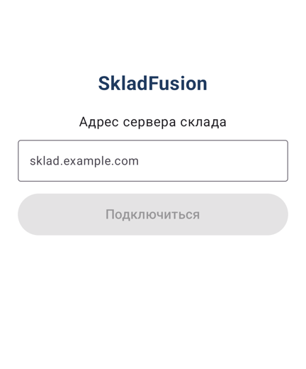
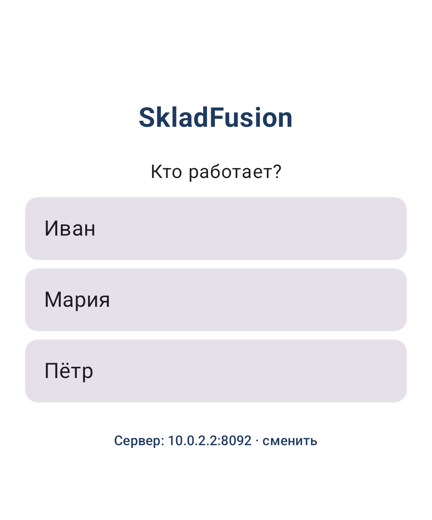

# SkladFusion — складская сборка заказов на Android для lsFusion

Приложение для кладовщика и сервер к нему. Кладовщик собирает заказы покупателей на телефоне: видит фото товара и ячейку, сканирует штрихкоды, фотографирует собранную коробку, печатает этикетки. Учётная система на [lsFusion](https://lsfusion.org) (конфигурация на основе [MyCompany](https://github.com/lsfusion-solutions/mycompany)) отдаёт серверу товары и заказы и забирает итоги сборки; другую систему можно подключить по описанию API.

Телефон работает со своей локальной базой и подтягивает с сервера только изменения, поэтому склад продолжает работать и при плохой связи: действия копятся в очереди и уходят, когда сеть появится.

| Адрес сервера при первом запуске | Вход |
|---|---|
|  |  |

<!-- Скриншоты экранов сборки: положите PNG в docs/img/ (orders.png, pick.png, review.png) и добавьте сюда. -->
## Возможности

- **Сборка заказов.** Маршрут по порядку обхода ячеек, скан товара прибавляет 1, чужой товар — красный экран и вибрация. Вкладки «Собрать / Собрано / Все», отмена последнего скана, режим «Убрать», журнал сборки (кто, что и когда отметил). «Взять заказ» — только при связи, чтобы двое не собирали одно и то же.
- **Проверка перед завершением** и **фото собранной коробки**: фото уходит в учётную систему, а ссылку на страницу «Клиенту» (фото и состав без входа) можно отправить покупателю.
- **Адресное хранение.** Ячейки, размещение товаров, «Где лежит», «Разместить». Ячейки и основное место товара синхронизируются с учётной системой в обе стороны.
- **Сканирование** камерой (ML Kit) или аппаратным сканером в режиме клавиатуры.
- **Печать этикеток** товаров, ячеек и коробок на термопринтер у любого компьютера с Windows: этикетку рисует сервер (PNG со штрихкодом Code 128), печатает маленький агент на PowerShell. Товар без штрихкода получает свой EAN-13 при первой печати.
- **Пересчёт (инвентаризация)** по производителю: несколько человек считают параллельно, разница проводится в учётной системе.
- **Новые заказы с телефона**: покупатель из справочника или новый, вид цен, товары сканом.
- **Фото товара, вес и габариты** с телефона — уходят в карточку товара в учётной системе.
- **Доска заданий** в браузере и в приложении: задания складу, задачи владельцу, переписка с фото, работает без интернета (PWA, Web Push). Уведомления владельцу в Телеграм — по желанию.
- **Автообновление приложения** со своего сервера, без Google Play.
- Необязательно: **отгрузка через внешнюю службу** (вес и габариты коробки → трек и этикетка службы на принтер), **фото товаров из каталога** (выгрузка с сайта или из учёта).

## Как устроено

```
lsFusion (модули Sklad*)          Сервер склада (PHP 8.5 + MariaDB)          Телефоны (Android 8+)
  push: товары, заказы, ячейки ──▶  /api/erp/push                     ◀──▶  /api/sync?since=N   (только изменения)
  inbox: итоги, фото, пересчёты ◀── /api/erp/inbox (длинный опрос)     ◀──   /api/events        (очередь действий)
                                    доска заданий /board/  ◀── браузер ──▶   /img/<guid>.webp   (фото товаров)
                                    очередь печати  ◀── агент печати (Windows) ──▶ принтер этикеток
```

- Всё, что меняется, записывается в журнал `changelog` с растущей версией; телефон спрашивает «что нового после версии N».
- Действия телефона идут пачками с `uuid`: повтор ничего не дублирует.
- Учётная система — главная по товарам и заказам; сервер хранит адресное хранение и всё, что сделано на складе, пока учёт это не заберёт.

## Состав репозитория

| Папка | Что |
|---|---|
| `server/` | Сервер: PHP 8.5 без фреймворка, MariaDB. `public/` — корень сайта, `src/` — код, `sql/schema.sql` — схема, `bin/` — обслуживание, `tests/` — тесты, `agent/` — агент печати для Windows |
| `android/` | Приложение: Kotlin, Jetpack Compose. Название, пакет и адрес сервера — в `android/sklad.properties` |
| `lsfusion/` | Модули обмена для lsFusion (на основе MyCompany): настройки, ячейки, товары, заказы, пересчёты, проход обмена |
| `docs/` | Документация |

## С чего начать

1. [Установка сервера](docs/install-server.md) — nginx, PHP, MariaDB, cron, первые сотрудники.
2. [Приложение для Android](docs/android.md) — сборка со своим названием и адресом, ключ подписи, выкладка и автообновление.
3. [Подключение lsFusion](docs/lsfusion.md) — готовые модули; [описание API](docs/api.md) — для своей интеграции.
4. [Агент печати этикеток](docs/print-agent.md).
5. [Безопасность](docs/security.md) — ключи, HTTPS, резервные копии.
6. Необязательно: [отгрузка через внешнюю службу](docs/shipping.md), [доска заданий](docs/board.md).

## Требования

- Сервер: Linux, nginx, PHP 8.5 (pdo_mysql, gd с WebP, curl, mbstring, openssl), MariaDB 10.11+ (или 11), шрифт DejaVu Sans; HTTPS-сертификат.
- Телефоны: Android 8.0+, камера; аппаратный сканер — по желанию.
- Сборка приложения: JDK 25, Android SDK (compileSdk 36).
- Печать: компьютер с Windows 10/11 и принтер этикеток с драйвером Windows.

## Лицензия

[Apache License 2.0](LICENSE).

Об уязвимостях — не в открытые issues, а на uginzx@gmail.com (подробнее — [docs/security.md](docs/security.md)).
